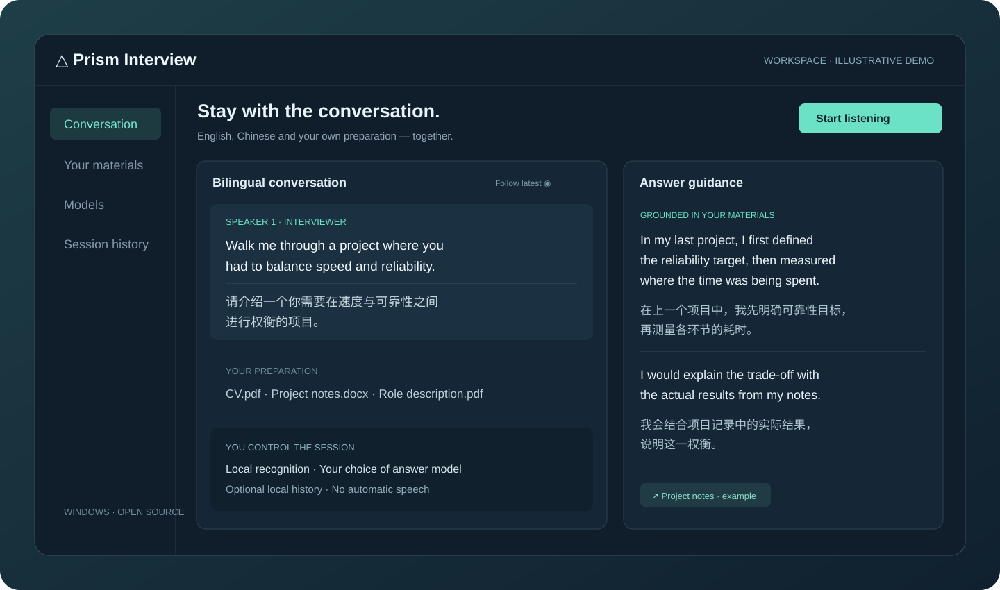

<p align="center"></p>
<h1 align="center">Prism Interview</h1>
<p align="center"><strong>Hear clearly. Answer with context.</strong><br>An open-source bilingual interview workspace for Windows.</p>
<p align="center"><a href="https://fbhSCI.github.io/prism-interview/">Explore the product</a> · <a href="https://github.com/fbhSCI/prism-interview/releases">Download</a> · <a href="README_中文.md">简体中文</a> · <a href="docs/GETTING_STARTED.md">Setup guide</a></p>



Prism Interview connects English speech, paired Chinese translations, your own preparation materials, and answer suggestions in one desktop workspace. Bring a CV, a job description, presentation slides, or reference documents. Choose a local model or configure your preferred provider. Keep complete bilingual text in view while the conversation continues.

**Preview release · Windows x64 · Python 3.11/3.12 · MIT application source**

<details><summary>See the actual Windows interface (synthetic example)</summary>


</details>

## A workspace built around the conversation

- **Listen locally.** Windows WASAPI loopback captures the selected playback device. Local Whisper speech recognition supports GPU acceleration; single remote speaker is the default, with optional anonymous multi-speaker grouping.
- **Read paired translations.** English and Chinese stay together, with stable updates, optional follow-latest, resizable/floating panels, and a transparent caption overlay.
- **Answer with your context.** Import PDF, Word, and PowerPoint files. Retrieval and evidence cards bring relevant excerpts into the selected model's prompt. Personal claims require evidence; importing a paper does not make you its author.
- **Choose your models.** Local Ollama, configured OpenAI-compatible services, DeepSeek, Qwen, and optional official Codex integration. Recognition, translation, and answer generation have separate settings and workers.
- **Control assistance.** Automatic and manual question handling, indirect requests, follow-up collection, cancellation, and answer history. No automatic speaking or sending.
- **Keep a local record, if you choose.** Save conversations manually or enable optional auto-save. Browse saved sessions and export JSON, Markdown, or text. Auto-save starts off; raw audio is not included.

## Get started

### Windows application

Download the Windows archive from [Releases](https://github.com/fbhSCI/prism-interview/releases), extract the **entire folder**, and run `PrismInterview.exe`. Keep `_internal` beside it. The application bundle and speech/translation model weights are separate; see the setup guide before the first interview.

### Run from source

Install Python 3.11 or 3.12 x64. Extract or clone this repository into a writable folder, then run in PowerShell:

```powershell
.\setup_windows.ps1 -Gpu -ModelDirectory 'D:\PrismInterviewModels'
.\start_windows.bat
```

The setup script creates `.venv`, installs dependencies, and offers model downloads. Use an ASCII temporary path if prompted. Allow several gigabytes for dependencies and models. See [the full guide](docs/GETTING_STARTED.md) for noninteractive setup and RTX 4060 deployment.

1. Select the output device used by Zoom and run the audio check.
2. Choose local translation or explicitly authorize a cloud translation provider.
3. Import your own preparation materials and fill in your background and target role.
4. Configure an answer model. Enter API keys **inside the application**, never in source code.
5. Start listening when the participants have agreed. Try a short mock interview before relying on the workspace.

## Your data, with explicit boundaries

First launch does not start capture, contact a model, or import another installation's settings. This public edition uses a separate data directory and Windows Credential Manager namespace. It contains no private candidate materials, preset API keys, or recorded interview sessions.

Speech recognition runs on this computer. Local inference can keep the full workflow offline. When you select cloud answers, the question and selected document excerpts go to that provider. Cloud caption translation sends confirmed English segments and limited context only after separate consent. Provider billing and terms apply.

Saved sessions are plaintext local files containing conversation content. They are not encrypted. Avoid sharing them accidentally. The app does not save audio with conversation history. Read [privacy and data flow](docs/PRIVACY.md).

## Expectations

This is an assistive tool. Recognition, speaker grouping, translation, retrieval, and generated answers can make mistakes. Review technical claims and use it in line with your interview's rules. End-to-end delay depends on hardware, speech cadence, network, and chosen models; this project does not promise instant or always-correct answers. RTX 4060 compatibility does not establish a measured laptop performance guarantee.

## Develop and contribute

```powershell
.\.venv\Scripts\python.exe -m pip install -r requirements-dev.txt
.\.venv\Scripts\python.exe -m pytest tests -q
.\build_windows.ps1 -IncludeGpuLibraries
```

The source retains the internal Python package name `zoom_copilot` for compatibility. See [architecture](docs/ARCHITECTURE.md), [contribution guide](CONTRIBUTING.md), and [security policy](SECURITY.md). Licensed external recordings and private evaluation materials are intentionally absent; corresponding tests skip when those files are unavailable.

## License

Application source: [MIT](LICENSE). Dependencies, Qt libraries, speech/translation models, and optional engines keep their own licenses. Model weights are downloaded separately. See [third-party notices](THIRD_PARTY_NOTICES.md) before redistributing a build. Zoom is a third-party product; this project is independent and is not endorsed by Zoom or model providers.

