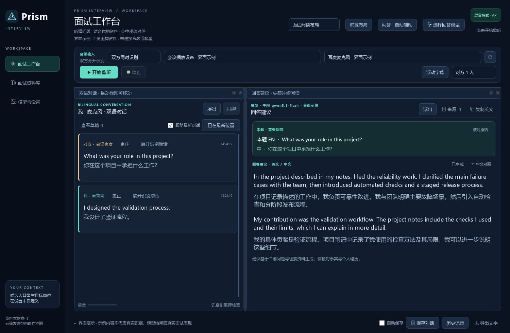

<h1 align="center">Prism Interview</h1>

<strong>英语面试实时听译，结合自己的资料准备回答。</strong>

<a href="https://fbhsci.github.io/prism-interview/">产品主页</a> · <a href="https://github.com/fbhSCI/prism-interview/releases">下载 Windows 版</a> · <a href="README.en.md">English</a> · <a href="docs/GETTING_STARTED.md">安装指南</a>

面试官在 Zoom 中用英语提问，Prism Interview 显示英文和对应中文，自动收集问题，再结合你提前导入的简历、PPT、论文或项目材料，生成逐段中英对照的回答建议。

适用于研究岗位、技术面试和需要讨论专业问题的英语会议。软件运行在 Windows 上，不需要接入 Zoom 的付费 API。

## 面试时怎么帮你

- **持续听译。** 本机 Whisper 识别英语，千问翻译；字幕和回答分开处理，生成答案时字幕继续更新。
- **自动收集问题。** 支持提问、续问，以及“请介绍你的方法”这类没有问号的请求。开启自动辅助后可直接等待建议，也能手动修改问题。
- **结合自己的方向。** 提问时检索你导入的相关资料，再组织回答；回答旁可查看使用的来源。填写自己的职责、贡献和目标岗位，有助于回答贴近本人。
- **双方分开显示。** 可选“会议／电脑声音”“麦克风／耳麦”或“双方同时识别”，按来源标记“对方”和“我”。自己的话只做听译，不触发自动回答。建议戴耳机，避免外放声被重复采集。

支持透明浮动字幕、可拆分面板、本机历史记录和 TXT／Markdown／JSON 导出。自动保存默认关闭，不保存录音。

## 新手安装：按顺序做这六步

推荐 Windows 10/11 64 位、16 GB 内存和 NVIDIA RTX 显卡。CPU 也可使用，识别通常更慢。

1. 在[下载页](https://github.com/fbhSCI/prism-interview/releases)的 **Assets** 中下载 **PrismInterview-0.4.1-Windows-Setup.zip**，完整解压。
2. 双击 **安装PrismInterview.cmd**，按窗口提示安装。首次会下载所需运行文件；已有 0.4.0 的用户可选择旧目录复用运行库。完成后打开桌面 **Prism Interview 0.4.1**。**不需要 Python 或管理员权限。**
3. 点击 **配置千问 API Key**，按下一节填好密钥和授权。
4. 在 **模型与设置** 点击 **下载／检查语音模型**，等待完成；已有模型可将“模型缓存”指向原模型文件夹后检查。
5. 在 **面试资料库** 导入自己的材料，在 **模型与设置 → 面试背景** 填写方向、目标岗位和实际贡献。
6. 回到工作台，选好会议输出及耳麦麦克风，点击 **开始监听**。先请同伴问几句英文，确认字幕、问题和回答来源，再用于正式面试。

拿到含模型的完整迁移包时，完整解压后直接运行 **PrismInterview.exe**。[详细安装、迁移和排错步骤](docs/GETTING_STARTED.md)

## 千问 API Key 怎么填

新安装默认选择 **千问 `qwen3.8-flash`**。建议先使用 Flash 完成模拟面试，再按自己的材料比较其他模型。[官方模型列表](https://www.alibabacloud.com/help/en/model-studio/models)

1. 在[阿里云百炼控制台](https://bailian.console.aliyun.com/)创建 API Key，记下所属地域；不熟悉控制台可看[官方获取指南](https://help.aliyun.com/zh/model-studio/get-api-key)。
2. 软件里点击 **配置千问 API Key**，提供方选 **千问 Qwen**，地域与密钥一致，把 Key 粘贴到 **API Key** 输入框，点击 **记住本机默认密钥**。
3. **选中模型** 保留 `qwen3.8-flash`，勾选允许发送问题和相关材料。按账户情况确认免费额度，或主动勾选 **允许千问使用付费余额**；点击 **测试短回答**，正常后点 **使用此模型**。
4. 到 **模型与设置**，确认字幕模型为 `qwen3.8-flash`，字幕接口与该 Key 的地域／业务空间一致，勾选 **允许持续英译中使用千问云服务**，保存设置。

Key 只填在软件中。软件开源免费，云模型费用由服务商结算。连续字幕和回答分别授权，语音识别始终在本机运行；也保留本地 Argos 翻译、Ollama、DeepSeek、自定义接口及官方 Codex 接入。

## 材料怎样参与回答

支持 PDF、Word（`.docx`）、PPT（`.pptx`）、TXT 和 Markdown。准备简历、个人贡献说明、汇报材料及相关文献，让软件知道“你做了什么”，也知道问题涉及哪些方法和背景。

导入后建立本地索引，每次提问检索相关片段；新增资料导入后即可使用，修改文件后需重新导入。这是检索增强，不是重新训练模型。[用模拟问题检查资料是否命中](docs/SAMPLE_INTERVIEW.md)

识别、翻译和建议都可能有误，正式面试前请核对关键结论。云回答会发送当前问题、所选背景、近期问答和相关片段；不会自动上传整份资料库。[数据处理说明](docs/PRIVACY.md)

[源码安装与构建](docs/GETTING_STARTED.md#source-installation) · [贡献指南](CONTRIBUTING.md) · [MIT 许可证](LICENSE) · [第三方许可证](THIRD_PARTY_NOTICES.md)
