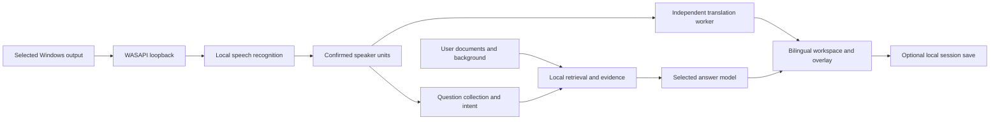

# Architecture

`zoom_copilot/app.py` coordinates workers and Qt signals. Recognition, translation and answer generation have independent lifecycle/cancellation. Question packets separate speech context, focused requests, speaker attribution and evidence. Documents are extracted and searched locally; facts and candidate profiles distinguish reference knowledge from supported personal claims.

`runtime.py`, configuration and credential storage isolate public-edition data. `session_store.py` persists explicit versioned local snapshots independently of preferences or credentials. UI history reads records without replaying capture or cloud tasks.

The internal package name is retained to reduce migration risk. Optional engines remain adapters rather than bundled hosted services. Tests use isolated directories and synthetic fixtures. External recording fixtures and personal scientific evaluation corpora are not redistributed.

