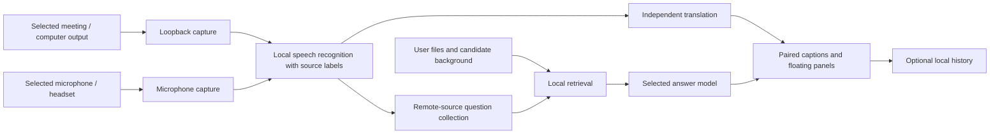

# Architecture

The user chooses meeting output, microphone input or both. Source labels identify which input supplied the speech; they do not prove a person's real identity. Microphone speech is captioned without triggering automatic interview answers. A source/device change must stop the old capture cleanly before the new selection starts.

`zoom_copilot/app.py` coordinates Qt signals and worker lifecycles. Recognition, translation and answers run independently. Question packets keep the focused request and its relevant context together. Retrieved passages and candidate facts help distinguish the candidate's work from reference material and proposed future work.

Documents are extracted and indexed locally. Each answer receives relevant excerpts, not an automatic full-corpus upload or a newly trained model. Cloud captions have separate consent from cloud answers.

`runtime.py` and configuration isolate the public edition's data directory. Windows Credential Manager stores keys under an application/provider/endpoint scope. `session_store.py` writes explicit local snapshots; opening history does not restart capture or send a model request.

The internal Python package remains `zoom_copilot`. Optional engines are adapters. Tests use isolated data and synthetic fixtures; private materials and third-party recordings are not distributed.
