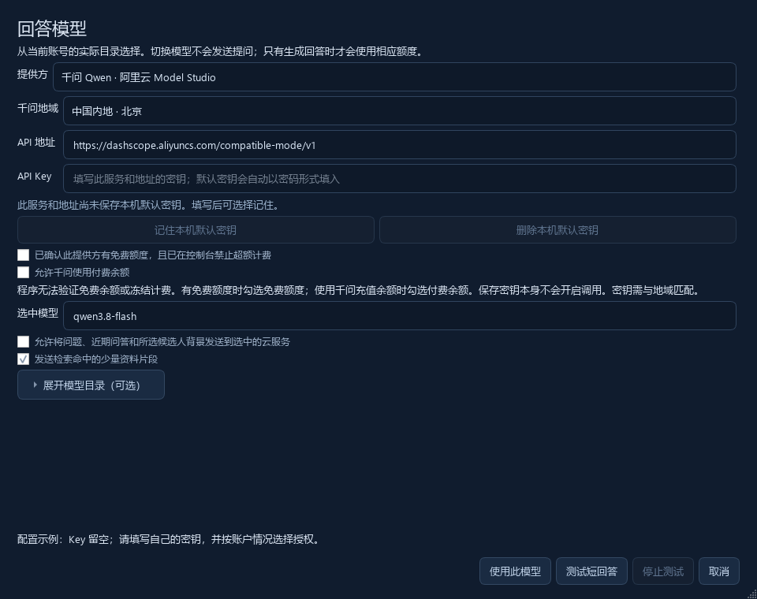

# 安装和第一次面试

[返回项目首页](../README.md) · [English quick start](../README.en.md)

这份指南按实际使用顺序写：先打开软件，再接好声音和模型，最后导入材料、做一次模拟面试。第一次准备需要联网下载语音模型；面试开始后不应再临时安装。

## 1. 安装 Windows 程序

1. 打开 [Releases 下载页](https://github.com/fbhSCI/prism-interview/releases)，进入最新版本。
2. 展开 **Assets**，下载 **PrismInterview-0.4.1-Windows-Setup.zip**。
3. 右键压缩包，选择“全部解压”，打开解压后的 `PrismInterview-Setup` 文件夹，双击 **安装PrismInterview.cmd**。
4. 如果已安装 0.4.0，按提示粘贴旧程序文件夹路径来复用运行文件；首次安装直接按回车，安装器会从官方 GitHub 获取所需文件。首次下载可能需要数分钟，窗口会显示状态，请等它提示“安装完成”。
5. 打开桌面的 **Prism Interview 0.4.1**，再继续下面的设置。安装器不会自动启动程序或监听。

安装不需要 Python 或管理员权限。默认位置是当前 Windows 用户的 `%LOCALAPPDATA%\Programs\PrismInterview\0.4.1`。旧程序、资料、设置和密钥不会被覆盖。

想装到其他磁盘时，在解压后的文件夹打开 PowerShell，执行：

```powershell
.\安装PrismInterview.cmd -DestinationDirectory 'D:\PrismInterview\0.4.1'
```

Windows 10/11 64 位可用；推荐 16 GB 内存和 NVIDIA RTX 显卡。使用 NVIDIA 显卡时先安装适合本机的显卡驱动。CPU 也能识别，但等待通常更长。

如果收到的是含模型的**完整迁移包**，完整解压后可直接打开 `PrismInterview.exe`，不必再运行安装器；已有模型无需重复下载。

## 2. 准备本地语音识别

1. 打开 **模型与设置**。
2. 识别模型先保留 **large-v3-turbo**，运行设备保留“自动选择”。
3. 点击 **下载／检查语音模型**，等待底部状态提示完成。缓存目录空间不足时，将“模型缓存”改到空闲磁盘，再保存和重试。
4. 回到工作台。看到准备完成后再继续，先不要在正式会议中做首次下载。

语音识别在你的电脑上运行。千问的 API Key 用于翻译和回答，不会替代本地语音模型。

## 3. 填写千问 API Key

新安装默认使用 **千问 `qwen3.8-flash`**。建议先用这个配置完成第一次测试，再比较其他模型。[官方型号说明](https://www.alibabacloud.com/help/en/model-studio/models)可查看各型号的定位与支持范围。

### 获取自己的密钥

打开[阿里云百炼控制台](https://bailian.console.aliyun.com/)，进入 API Key 管理，创建密钥并复制。第一次使用百炼可按[官方指南](https://help.aliyun.com/zh/model-studio/get-api-key)操作。记下密钥所在地域；软件中的地域和接口需要与它匹配。

### 配置回答模型



1. 点击工作台上的 **配置千问 API Key**，或顶部 **选择回答模型**。
2. 提供方选择 **千问 Qwen**，选中与密钥对应的地域。
3. 把密钥粘贴到 **API Key**，点击 **记住本机默认密钥**。密钥会保存在这个 Windows 用户的凭据管理器中，换电脑后需重新填写。
4. **选中模型** 填写 `qwen3.8-flash`。如果你的地域没有这个型号，点击“刷新官方目录”或对照百炼控制台选择可用型号。
5. 勾选允许发送问题、面试背景和检索到的资料片段。使用免费额度时先在平台核实余额和限制；接受按量计费时主动勾选 **允许千问使用付费余额**。
6. 点击 **测试短回答**。看到英文和中文正常返回后，点击 **使用此模型**。

软件不会赠送额度，也不能替你冻结服务商账单。API 费用以所选账户和平台为准。密钥只填在软件输入框中。

### 配置字幕翻译

字幕和回答分别设置，方便你只开其中一种，也方便独立调整模型。

1. 进入 **模型与设置**，把 **翻译引擎** 选为 **千问 Qwen · 连续字幕云翻译**。
2. **字幕千问模型** 填 `qwen3.8-flash`。
3. 确认 **字幕千问接口** 与刚才密钥的地域相同。如果回答界面使用业务空间专属地址，将对应地址填在这里。
4. 新安装默认勾选 **允许持续英译中使用千问云服务**；不需要时可以取消，点击 **保存设置**。旧设置中明确关闭的选项会继续保持关闭。

启动软件不会自动监听或上传。选用千问翻译并完成密钥和额度设置后，点击 **开始监听** 才会把确认的英文语段发给千问，包括所选麦克风的英文；不会发送音频，服务商可能计费。

如果只想离线翻译，将引擎改为 Argos，点击 **准备离线英译中模型**。专业术语和长句请多核对原英文。

## 4. 选择从哪里收音

先在工作台选择输入来源，再选对应设备。

| 你想识别什么 | 选择的来源 | 设备怎么选 |
| --- | --- | --- |
| Zoom 面试官的英语 | 会议／电脑声音 | 与 Zoom“扬声器”设置相同的耳机或扬声器 |
| 自己对耳麦说的英语 | 麦克风／耳麦 | 与 Zoom“麦克风”设置相同的耳麦麦克风 |
| 双方的英语 | 双方同时识别 | 分别指定上述输出设备和麦克风 |

“会议／电脑声音”采集所选播放设备里的声音，也会听到其他应用通过它播放的音频。听不到对方时，先检查 Zoom 的扬声器选择和音量。

“双方同时识别”按来源显示“对方 · 会议声音”和“我 · 麦克风”。自己的麦克风发言用于字幕和翻译，不会把自己正在回答的话再当成面试官的问题自动作答。多人会议中的远端分组仍可能不准确，不会凭声音确认真实身份。

建议戴耳机，减少外放声音再次进入麦克风。蓝牙耳机在通话时可能切换播放或麦克风设备；如果声音消失，刷新设备列表并重新选择。切换输入来源后，按界面提示重新开始监听。

## 5. 把自己的材料准备好

在 **面试资料库 → 导入资料** 中添加 PDF、`.docx`、`.pptx`、TXT 或 Markdown。扫描 PDF 需要先做文字识别。导入完成后，确认文件显示为已建立本地索引。

| 材料 | 它能帮助回答什么 |
| --- | --- |
| 简历、个人贡献说明 | 你的职责、经历、成果和负责范围 |
| 汇报 PPT、讲稿、项目说明 | 方法设计、实验过程、技术选择与限制 |
| 论文、技术文档 | 理论依据、相关工作、对比方法及出处 |
| 岗位说明、研究计划 | 为什么适合这个岗位，以及准备怎样开展工作 |

然后到 **模型与设置 → 面试背景** 填写两部分：目标岗位或研究方向；你已经完成的工作和实际贡献。让资料说清楚“我做了什么”，比单纯增加论文数量更有帮助。

材料在本机提取、建立索引。每次提问时，软件选出相关片段交给回答模型；不是把全部资料重新读一遍，也不是训练出一个新模型。新增文件导入后即可参与后续检索；修改原文件后，需要重新导入。

回答旁的 **来源** 可查看本次使用的材料。对结论、数字、个人贡献有疑问时，回到原文件核对。

## 6. 用几分钟做一次模拟面试

1. 在 Zoom 里让另一位参会者说一句英文，点击 **开始监听**，确认音量条有反应。
2. 检查他的英文和中文是否成组显示，是否出现了不属于会议的背景声音。
3. 若开启“双方同时识别”，自己也说一句英文，确认它标记为“我”，且不会触发自动回答。
4. 让对方问[模拟面试中的问题](SAMPLE_INTERVIEW.md)。开启 **问答 · 自动辅助**，检查当前问题及回答建议。
5. 问一个只有你的资料里才有细节的问题，点击回答旁的 **来源**，确认没有用成别人的贡献或无关资料。
6. 调整面板大小或打开浮动字幕，直到能直接阅读中英内容。

识别、翻译、问题收集和回答生成是不同步骤。先看是哪一步等待较长，再调整对应设置；换回答模型不会加快本地英语识别。Flash 适合作为速度优先的起点，最终效果需要用自己的材料验证。

## 7. 保存和迁移

底部 **保存对话** 会保存当前记录；**历史记录** 可查看、删除和导出 TXT／Markdown／JSON。**自动保存** 默认关闭，打开后会定期保存。记录包含双语、问题、完成回答及相关证据片段，不包含原始录音；文件保存在本机且未加密。

迁移到另一台电脑时，复制完整程序目录到一个新文件夹，保留模型及许可证。新电脑安装合适的显卡驱动，重新填写 API Key，导入自己的材料，再重复第 6 节的模拟测试。不要把源码安装的 `.venv` 整体搬过去，应重新创建环境。

可把下面这段话交给另一台电脑上的 Codex：

> 请只操作这份 Prism Interview，保留其他安装。先读 AGENTS.md 和 docs/GETTING_STARTED.md，检查 Windows、显卡驱动、模型目录与可用空间。优先使用已有便携程序，缺模型时通过软件的“下载／检查语音模型”准备。不要读取其他应用的密钥。我会在软件里填写千问 Key 并选择授权。帮我选择 Zoom 输出与耳麦麦克风、导入自己的资料，再按指南做模拟通话，报告实际结果。不要把本机播放测试称为双端 Zoom 验收。

## 常见问题

| 现象 | 先检查这里 |
| --- | --- |
| 双击没打开 | 完整解压后运行；保留 `_internal`。可运行 `start_windows.bat` 查看错误提示。 |
| 有声音但没英文 | 来源和设备是否正确；本地语音模型是否准备完成；音量条是否变化。 |
| 有英文但没有中文 | 千问字幕授权、地域、接口与 Key；若使用本地翻译，检查模型是否安装。 |
| API Key 无效／模型不存在 | 密钥所属地域、业务空间和接口是否对应；所选模型是否在该地域可用。 |
| 欠费或额度不足 | 去服务商控制台查看账户与额度；保存密钥不代表已经有可用额度。 |
| 回答像通用模板 | 检查自己的资料是否导入成功、面试背景是否填写，以及“来源”是否命中相关内容。 |
| 更新文件后回答没变化 | 重新导入修改后的文件，等索引完成后再提问。 |

<a id="source-installation"></a>

## 源码安装与开发

以下适合希望修改源码的用户。安装 [Python 3.11 或 3.12 x64](https://www.python.org/downloads/windows/)，下载源码包，解压到新的文件夹。在该文件夹打开 PowerShell，执行：

```powershell
powershell -NoProfile -ExecutionPolicy Bypass -File .\setup_windows.ps1 -Gpu -ModelDirectory 'D:\PrismInterviewModels' -TemporaryDirectory 'D:\PrismInterviewTemp' -DownloadAsr -DownloadTranslation
.\start_windows.bat
```

上面使用 D 盘保存模型和安装临时文件；没有 D 盘时，替换为自己空闲磁盘上的英文目录。脚本会创建 `.venv`、安装依赖并下载模型；窗口提示完成后再启动。CPU 用户去掉 `-Gpu`，脚本询问是否安装 NVIDIA 运行库时输入 `n`。

源码安装所需空间比便携程序多，安装脚本会检查空间并显示错误；出现不足时改用空闲磁盘。依赖下载和模型下载失败请分别看错误来源，保留不含密钥和私人文本的报错用于反馈。

开发测试和构建：

```powershell
.\.venv\Scripts\python.exe -m pip install -r requirements-dev.txt
.\.venv\Scripts\python.exe -m pytest tests -q
.\build_windows.ps1 -IncludeGpuLibraries -OutputDirectory 'D:\PrismBuild'
```

应用源码采用 MIT 协议，模型和依赖遵守各自许可证。分发自己的构建前请读 [THIRD_PARTY_NOTICES.md](../THIRD_PARTY_NOTICES.md)。
